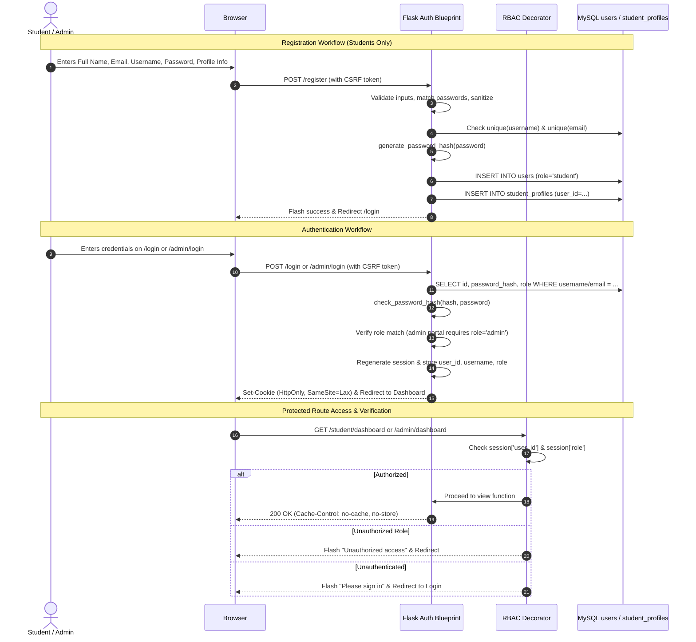

# Authentication & Authorization Architecture Documentation

**Project Title:** Intelligent Course Recommendation System  
**Phase:** Phase 3 — Complete Student and Admin Authentication System  
**Security Framework:** Werkzeug Security, Flask-WTF (CSRF), Flask Session Management, Role-Based Access Control (RBAC)

---

## 1. Architectural Overview & Workflow Diagrams

The authentication and authorization architecture isolates student self-service capabilities from administrative controls. All sensitive credentials are encrypted using salted one-way hashes, sessions are hardened with modern HTTP cookie flags, and endpoints are guarded by reusable role decorators.



---

## 2. Core Security Components

### 2.1 Password Hashing Strategy
- **Library:** `werkzeug.security` (`generate_password_hash`, `check_password_hash`).
- **Algorithm:** Uses salted, adaptive scrypt/PBKDF2-HMAC algorithms.
- **Salt Generation:** Unique, cryptographically secure random salts are generated per user hash automatically.
- **Plain-Text Prohibition:** Raw passwords never touch database storage, log outputs, or error traces.

### 2.2 Session Security & Cookie Hardening
Configured via `config.py` and `app.py`:
- **`SESSION_COOKIE_HTTPONLY = True`**: Mitigates Cross-Site Scripting (XSS) by preventing JavaScript from accessing the session cookie.
- **`SESSION_COOKIE_SAMESITE = 'Lax'`**: Protects against Cross-Site Request Forgery (CSRF) by restricting cookie transmission on third-party requests.
- **`SESSION_COOKIE_SECURE`**: Set to `False` for local development HTTP and `True` for HTTPS production environments.
- **`PERMANENT_SESSION_LIFETIME = timedelta(hours=2)`**: Enforces automatic session expiration after inactivity.
- **Session Regeneration:** Calling `session.clear()` upon login and logout prevents session fixation attacks.
- **Cache Invalidation (`@no_cache`):** Sends `Cache-Control: no-cache, no-store, must-revalidate` on all protected views to prevent browser back-button caching after logout.

### 2.3 CSRF Protection
- **Extension:** `Flask-WTF` (`CSRFProtect`).
- **Implementation:** Enabled globally in `app.py`. All POST forms (`register.html`, `login.html`, `admin_login.html`) inject the token via `<input type="hidden" name="csrf_token" value="{{ csrf_token() }}">`.
- Requests lacking valid tokens are aborted immediately with HTTP 400 Bad Request.

---

## 3. Role-Based Access Control (RBAC) & Decorators

Reusable decorators defined in `routes/decorators.py`:

| Decorator | Target Views | Enforcement Behavior |
| :--- | :--- | :--- |
| **`@login_required`** | Any authenticated endpoint | Validates `session['user_id']`. Redirects unauthenticated requests to `/login` or `/admin/login` preserving the `next` query parameter. |
| **`@role_required(*allowed_roles)`** | Specific role endpoints | Verifies `session['role'] in allowed_roles`. Redirects unauthorized roles to their own dashboard with a security warning. |
| **`@student_required`** | Student portal (`/student/*`) | Restricts access strictly to accounts with `role == 'student'`. |
| **`@admin_required`** | Admin portal (`/admin/*`) | Restricts access strictly to accounts with `role == 'admin'`. |
| **`@no_cache`** | Sensitive dashboard responses | Appends HTTP headers disabling browser cache storage. |

---

## 4. Administrator Account Provisioning

To prevent public exploitation, administrative self-registration is strictly disallowed. Administrator accounts must be created using controlled channels:

1. **Standalone CLI Utility (`create_admin.py`):**
   ```powershell
   .\venv\Scripts\python.exe create_admin.py
   ```
   Interactively and securely prompts for username, email, and password using `getpass` (hidden input without terminal echoing).

2. **Flask CLI Command:**
   ```powershell
   flask create-admin
   ```
   Integrated into Flask's CLI runner with validation and secure password confirmation.

---

## 5. Automated Test Results

The test suite in [`test_auth.py`](file:///z:/Intelligent-Course-Recommendation/test_auth.py) was executed against the live MySQL database:

```text
test_A1_student_registration_success ... ok
test_A2_student_registration_duplicate_email_rejected ... ok
test_A3_student_registration_password_mismatch_rejected ... ok
test_A4_student_login_invalid_credentials_rejected ... ok
test_A5_student_login_and_dashboard_success ... ok
test_A6_student_logout_success ... ok
test_B1_admin_account_creation_via_utility ... ok
test_B2_admin_login_invalid_credentials_rejected ... ok
test_B3_admin_login_and_dashboard_success ... ok
test_C1_student_cannot_access_admin_dashboard ... ok
test_C2_admin_cannot_access_student_dashboard ... ok
test_C3_student_cannot_login_through_admin_portal ... ok
test_C4_unauthenticated_cannot_access_protected_pages ... ok
test_C5_cache_control_headers_on_protected_pages ... ok

----------------------------------------------------------------------
Ran 14 tests in 3.026s

OK
```

### Verification Matrix
- **Student Registration:** Successful account and `student_profiles` creation verified.
- **Uniqueness Enforcement:** Duplicate email and username registrations rejected with distinct flash messages.
- **Student Authentication:** Verified password checking and dashboard access.
- **Admin Authentication:** Separate `/admin/login` interface verified with administrative privilege enforcement.
- **Cross-Role Segregation:** Students attempting to open `/admin/dashboard` or log in through `/admin/login` are rejected; admins cannot open student-only views.
- **Session Revocation:** `/logout` successfully clears sessions; subsequent visits return HTTP 302 to `/login`.
- **Cache-Control:** `no-store, no-cache` confirmed on authenticated responses.
