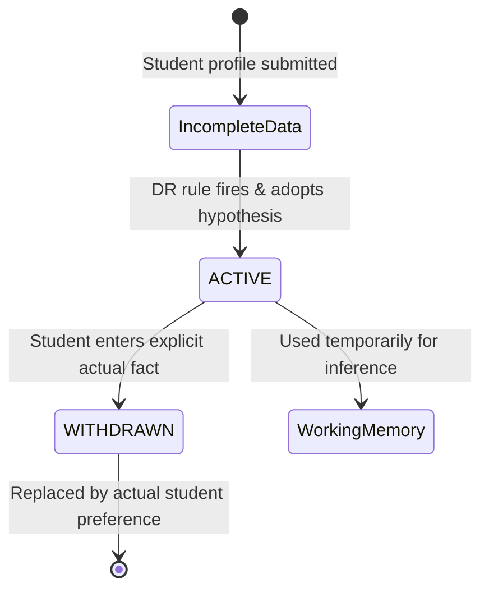
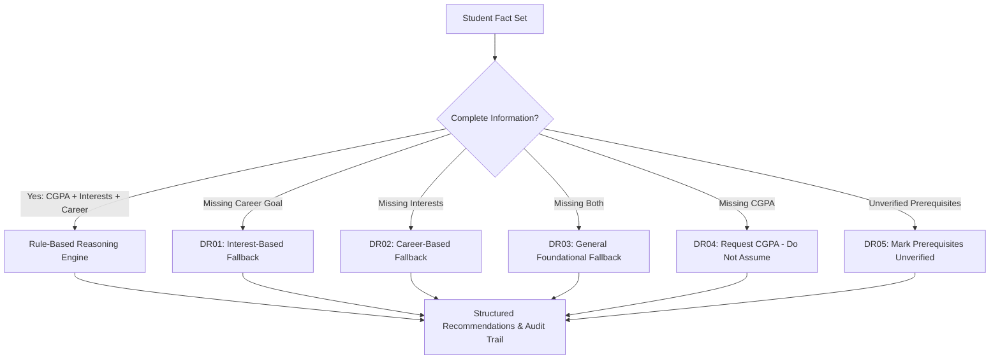

# Phase 8: Default Reasoning Engine Documentation
**Project:** Intelligent Course Recommendation System  
**Phase 8:** Non-Monotonic Default Reasoning & Assumption Management  
**Version:** 1.0.0 (Production Ready)  
**Safety Protocol:** Strict Zero Dynamic Code Execution (No `eval()` / `exec()`)

---

## 1. Overview of Default Reasoning

Default Reasoning is a branch of Non-Monotonic Knowledge-Based Artificial Intelligence (formalized by Raymond Reiter in 1980). Classical monotonic deduction requires complete information to infer conclusions; if information is missing, monotonic inference stalls or fails.

In real-world academic advising, students frequently present **incomplete profiles**:
- A freshman or transfer student may not yet have chosen a career goal.
- An incoming student may not have identified domain interests.
- A student transcript may lack course prerequisite completion history.
- An academic record may temporarily lack a CGPA.

**Default Reasoning** bridges this knowledge gap by formulating sound, tentative hypotheses (defaults) that hold in the absence of contrary evidence. Crucially, default logic is **non-monotonic**: if a student subsequently provides actual facts (e.g. selects a career goal), the default assumption is automatically **withdrawn (retracted)** and superseded by the student's actual preferences.

---

## 2. Canonical Default Rules (DR01 – DR05)

The system formalizes five canonical default rules:

$$\frac{\alpha : \beta}{\gamma} \quad \left(\frac{\text{Prerequisite} : \text{Justification}}{\text{Consequence}}\right)$$

### DR01 – Missing Career Goal (Interest-Based Fallback)
- **Antecedent:** Career goal is missing or empty, AND student technical interests are available.
- **Justification:** Consistent to infer recommendations directly from declared domain interests.
- **Consequence:** Generate interest-based course recommendations via ontology mappings.
- **Explanation:** *"Your career goal was not provided. Therefore, the system used your selected interests to identify suitable courses."*

### DR02 – Missing Interests (Career-Based Fallback)
- **Antecedent:** Technical interests are missing or empty, AND student career goal is declared.
- **Justification:** Consistent to infer required competencies directly from the career goal curriculum pathway.
- **Consequence:** Generate career-based course recommendations.
- **Explanation:** *"Your interests were not provided. Therefore, the system used your selected career goal to identify suitable courses."*

### DR03 – Missing Both Interests and Career Goal (General Foundational Recommendations)
- **Antecedent:** Both technical interests and career goals are undeclared.
- **Justification:** Consistent to suggest introductory breadth electives meeting basic standing.
- **Consequence:** Generate general foundational course recommendations (e.g., CS-402 Artificial Intelligence, CS-410 Internet of Things, CS-404 Cloud Computing).
- **Explanation:** *"Neither interests nor career goals were provided. These are general foundational recommendations and may not match your personal preferences."*

### DR04 – Missing CGPA (Academic Info Request)
- **Antecedent:** Student CGPA is missing or undeclared.
- **Safety Policy:** **Never assume or estimate a CGPA value.** Academic eligibility constraints cannot be bypassed.
- **Consequence:** Flag academic info required; mark courses requiring minimum CGPA verification as unverified/rejected.
- **Explanation:** *"Your CGPA is missing. Please provide your CGPA before eligibility can be confirmed."*

### DR05 – Unknown Prerequisites (Unverified Prerequisites)
- **Antecedent:** Course prerequisite transcript information is unprovided or unavailable.
- **Safety Policy:** **Never assume unknown prerequisites are satisfied.**
- **Consequence:** Mark candidate course eligibility as unverified.
- **Explanation:** *"Prerequisite completion status is unverified. Prerequisites cannot be assumed to be satisfied."*

---

## 3. Reasoning Priority & Hierarchy

To ensure user autonomy and logical soundess, inference strictly adheres to the following five-tier hierarchy:

1. **Actual Student Interests** (Hard facts take first precedence).
2. **Actual Career Goals** (Explicit student aspirations).
3. **Rule-Based Reasoning** (Deterministic production rules fire when complete facts are present).
4. **Default Reasoning** (DR01, DR02, DR05 apply when specific attributes are missing).
5. **General Recommendations** (DR03 applies only when both interest and career signals are absent).

**Golden Rule:** *Actual student information always supersedes default assumptions.*

---

## 4. Assumption Management Architecture

The [`AssumptionManager`](file:///z:/Intelligent-Course-Recommendation/ai_engine/assumption_manager.py) maintains active hypotheses, tracks their lifecycle, and governs non-monotonic belief revision.

### 4.1 Lifecycle of an Assumption

### 4.2 Key Guarantees
- **Non-Persistence of Assumptions:** Assumptions are marked `is_temporary=True` and are never written to the permanent student profile in MySQL.
- **Audit Logging:** Every assumption records `assumption_id`, `field`, `assumed_value`, `reason`, `source_rule`, `created_at`, and `withdrawn_at`.
- **Belief Revision (`reconcile_with_actual_data`):** When new student preferences are submitted, the manager immediately withdraws conflicting assumptions and triggers recommendation regeneration.

---

## 5. Integration with Rule-Based Reasoning

The Default Reasoning Engine integrates seamlessly with the existing [`RuleEvaluator`](file:///z:/Intelligent-Course-Recommendation/ai_engine/rule_evaluator.py) and MySQL Knowledge Base without duplicating code:

---

## 6. Sample Operational Scenarios

### Scenario 1: Early-Semester Student without Career Direction
- **Input:** CGPA: 3.40, Interests: *Machine Learning, Python*, Career Goal: *(None)*.
- **Execution:**
  - `DR01` fires: Career goal omitted.
  - Fallback: Uses domain interests.
  - Recommended: CS-401 Machine Learning.
  - Explanation: *"Your career goal was not provided. Therefore, the system used your selected interests to identify suitable courses."*

### Scenario 2: Career-Focused Student without Selected Topics
- **Input:** CGPA: 3.10, Interests: *(None)*, Career Goal: *Cybersecurity Analyst*.
- **Execution:**
  - `DR02` fires: Interests omitted.
  - Fallback: Uses career competency pathway.
  - Recommended: CS-405 Cyber Security.
  - Explanation: *"Your interests were not provided. Therefore, the system used your selected career goal to identify suitable courses."*

### Scenario 3: Undeclared Student (Both Missing)
- **Input:** CGPA: 2.80, Interests: *(None)*, Career Goal: *(None)*.
- **Execution:**
  - `DR03` fires: Both omitted.
  - Fallback: Foundational computing breadth electives.
  - Recommended: CS-402 Artificial Intelligence, CS-410 Internet of Things.
  - Explanation: *"Neither interests nor career goals were provided. These are general foundational recommendations and may not match your personal preferences."*

### Scenario 4: Missing CGPA
- **Input:** CGPA: *(None)*, Interests: *Deep Learning*, Career Goal: *AI Engineer*.
- **Execution:**
  - `DR04` fires: Missing CGPA.
  - Safety Policy: CGPA is never assumed.
  - Result: Academic info requested; eligibility unverified.
  - Explanation: *"Your CGPA is missing. Please provide your CGPA before eligibility can be confirmed."*

---

## 7. Administrative Control & Monitoring

Administrators manage default reasoning via the Admin Portal at [`/admin/default-rules`](file:///z:/Intelligent-Course-Recommendation/templates/admin_default_rules.html):
- **View All Default Rules:** Inspect codes (`DR01`–`DR05`), strategies, and templates.
- **Activate / Deactivate:** Toggle rules dynamically in MySQL with instant effect.
- **Security:** Pure declarative parameter toggles; strictly zero arbitrary code execution.

---

## 8. Automated Verification & Testing

Exhaustive automated testing is implemented in [`test_default_reasoning.py`](file:///z:/Intelligent-Course-Recommendation/test_default_reasoning.py):

| Test Case | Description | Result |
| :--- | :--- | :---: |
| **Test A** | Complete student info uses pure rule-based reasoning | **PASS** |
| **Test B** | Missing career goal triggers DR01 interest fallback | **PASS** |
| **Test C** | Missing interests triggers DR02 career fallback | **PASS** |
| **Test D** | Missing both triggers DR03 general foundational electives | **PASS** |
| **Test E** | Missing CGPA triggers DR04 request; never assumed | **PASS** |
| **Test F** | Unknown prerequisites triggers DR05; marked unverified | **PASS** |
| **Test G** | Newly provided career goal overrides default assumption | **PASS** |
| **Test H** | Newly provided interests override default assumption | **PASS** |
| **Test I** | Assumption withdrawal (retraction) and timestamps verified | **PASS** |
| **Test J** | Recommendation regeneration upon preference update verified | **PASS** |
| **Test K** | Inactive courses strictly excluded from recommendations | **PASS** |
| **Test L** | Minimum CGPA eligibility enforced in default reasoning | **PASS** |
| **Test M** | Admin activation/deactivation toggle verified | **PASS** |

**Default Reasoning Suite:** **13 / 13 Passed (100%)**  
**Full Project Regression Suite:** **91 / 91 Passed (100%)**
