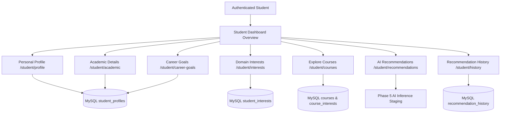

# Student Dashboard Technical Documentation

**Project Title:** Intelligent Course Recommendation System  
**Phase:** Phase 4 — Student Dashboard Development  
**Role:** Senior Python Flask Full Stack Developer & UI/UX Designer  
**Status:** Completed & Validated (10/10 Phase 4 Tests Passed, 14/14 Auth Tests Passed)

---

## 1. Dashboard Overview & User Interface Architecture

The Student Dashboard provides a responsive, role-protected interface for students to manage academic profiles, configure learning interests, select target career goals, explore elective courses, and inspect AI course recommendation logs.



---

## 2. Component Specifications

### 2.1 Personalized Student Dashboard (`student_dashboard.html`)
- **Personalized Banner:** Welcomes the logged-in student by name (`profile.full_name`).
- **Academic KPI Cards:**
  - Cumulative CGPA (scale $0.00 - 10.00$)
  - Semester Standing ($1 - 12$)
  - Selected Interests Count
  - Total Available Elective Courses Count (dynamically queried from MySQL `courses`)
- **Academic Profile Card:** Shows Department, Semester, CGPA, Roll Number, and Preferred Career Goal.
- **Recent Recommendation Activity:** Displays the latest recommendations with match score badges, course codes, difficulty levels, and reasoning justifications.

### 2.2 Responsive Sidebar Navigation (`components/student_sidebar.html`)
Includes Bootstrap icons and dynamic active tab highlighting for:
- `Dashboard` (`bi-speedometer2`)
- `My Profile` (`bi-person`)
- `Academic Details` (`bi-mortarboard`)
- `My Interests` (`bi-tags`)
- `Career Goals` (`bi-compass`)
- `Explore Courses` (`bi-grid-3x3-gap`)
- `AI Recommendations` (`bi-robot`)
- `Recommendation History` (`bi-clock-history`)
- `Logout` (`bi-box-arrow-right`)

### 2.3 Student Profile Management (`student_profile.html`)
- **View Information:** Displays username, registered email address, and current role (`student`).
- **Editable Fields:** Allows students to update Full Name, Department, Semester, and Roll Number.
- **Roll Number Collision Prevention:** Checks uniqueness against all other profiles in `student_profiles` to prevent duplicate student IDs.
- **Role Tamper Protection:** Role modification is strictly forbidden in backend handler logic.

### 2.4 Academic Details & CGPA Validation (`academic_details.html`)
- **CGPA Scale:** Validated strictly between `0.00` and `10.00` (rejects negative numbers or values $> 10.00$).
- **Semester Standing:** Supports standard university semester standings from $1$ to $12$.
- **Database Precision Upgrade:** Modified MySQL column `student_profiles.cgpa` to `DECIMAL(4, 2)` to natively store values up to `10.00` without truncation.

### 2.5 Domain Interests Management (`interests.html`)
- **Catalog Integration:** Dynamically loads available interest areas from the MySQL `interests` table.
- **Multi-Selection:** Students can select and unselect multiple interest tags via styled checkbox buttons.
- **Deduplication:** Prevents duplicate assignments by wiping prior associations and cleanly bulk-inserting unique interest pairs into `student_interests`.

### 2.6 Career Goals Selection (`career_goals.html`)
- **Directory Display:** Retrieves career pathways from the MySQL `career_goals` table with job descriptions.
- **Preference Storage:** Stores target goal via `student_profiles.career_goal_id` foreign key.
- **Clear Capability:** Students can update or clear their goal preference at any time.

### 2.7 Curriculum & Course Exploration (`explore_courses.html`)
- **Real-Time Client Search (`dashboard.js`):** Filters courses live as the user types course codes, titles, or tag keywords.
- **Difficulty Filter:** Filters between All, Beginner, Intermediate, and Advanced courses.
- **Detailed Metadata:** Displays course code, description, minimum CGPA required, prerequisites, career scope, and associated interest badges.

### 2.8 AI Recommendation Preview & Staging (`ai_recommendations.html`)
- **Educational Walkthrough:** Explains rule-based reasoning, default reasoning, and inference mechanics.
- **Profile Readiness Summary:** Verifies whether CGPA, semester, interests, and career goal are populated.
- **Generate Recommendations Trigger:** Button initiates recommendation evaluation staging and informs the user of Phase 5 inference engine execution.

### 2.9 Recommendation History & Audit Trail (`recommendation_history.html`)
- **Audit Listing:** Renders previous recommendations from `recommendation_history` with scores, timestamps, and reasoning.
- **Empty State:** Shows an intuitive empty state with direct navigation to the recommendation engine if no records exist.

---

## 3. Database Schema Migration

To support career goal associations and a $0-10$ CGPA scale, migration script [`database/migrate_phase4.py`](file:///z:/Intelligent-Course-Recommendation/database/migrate_phase4.py) was executed:

```sql
-- 1. Add career_goal_id foreign key to student_profiles
ALTER TABLE student_profiles
ADD COLUMN career_goal_id INT NULL AFTER cgpa,
ADD CONSTRAINT fk_student_career_goal
    FOREIGN KEY (career_goal_id) REFERENCES career_goals (id)
    ON DELETE SET NULL
    ON UPDATE CASCADE;

-- 2. Expand CGPA column precision to allow 10.00
ALTER TABLE student_profiles MODIFY COLUMN cgpa DECIMAL(4, 2) NOT NULL DEFAULT 0.00;
```

---

## 4. Backend Route Specifications ([`routes/student.py`](file:///z:/Intelligent-Course-Recommendation/routes/student.py))

| Method | Endpoint | Authorization | Description |
| :--- | :--- | :--- | :--- |
| `GET` | `/student/dashboard` | `@student_required` | Dashboard summary with KPIs, course count, and recent activity. |
| `GET, POST` | `/student/profile` | `@student_required` | View profile and update name, roll number, department, semester. |
| `GET, POST` | `/student/academic` | `@student_required` | Update standing semester and validate/store CGPA ($0.00 - 10.00$). |
| `GET, POST` | `/student/interests` | `@student_required` | Multi-select and persist student interest tags. |
| `GET, POST` | `/student/career-goals` | `@student_required` | Select, update, or clear preferred industry career goal. |
| `GET` | `/student/courses` | `@student_required` | Curriculum catalog with live search and difficulty filtering. |
| `GET, POST` | `/student/recommendations` | `@student_required` | AI recommendation explanation page and staging trigger. |
| `GET` | `/student/history` | `@student_required` | Complete recommendation history log and empty-state handler. |

**Cross-Student Isolation:** Every route queries data strictly using `session['user_id']`. Students cannot inspect or alter another student's profile, interests, or recommendation records.

---

## 5. Automated Test Results

The test suite in [`test_student_dashboard.py`](file:///z:/Intelligent-Course-Recommendation/test_student_dashboard.py) was executed:
```powershell
.\venv\Scripts\python.exe test_student_dashboard.py
```

### Results:
```text
test_1_dashboard_loads_with_correct_details ... ok
test_2_profile_updates_are_saved ... ok
test_3a_valid_cgpa_accepted ... ok
test_3b_invalid_cgpa_rejected ... ok
test_4_interests_add_and_remove ... ok
test_5_career_goals_selection_and_clearing ... ok
test_6_courses_exploration_loads_from_mysql ... ok
test_7_ai_recommendation_staging_page ... ok
test_8_recommendation_history ... ok
test_9_cross_student_data_isolation ... ok

----------------------------------------------------------------------
Ran 10 tests in 4.405s

OK
```

All 10 Phase 4 tests and all 14 Phase 3 authentication regression tests passed without errors.
