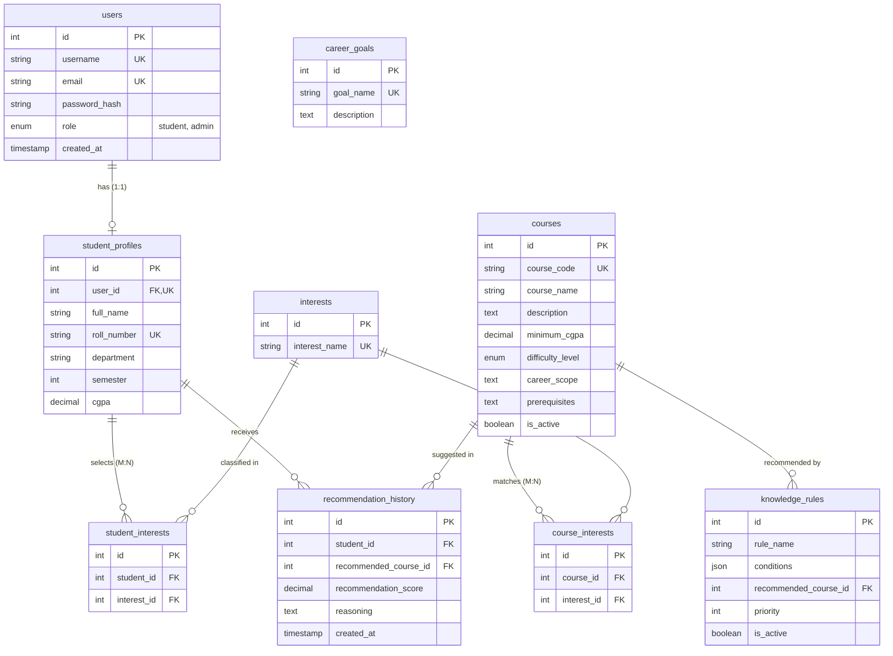

# Database Architecture & Design Documentation

**Project Title:** Intelligent Course Recommendation System  
**Phase:** Phase 2 — MySQL Database Design and Implementation  
**Target Database:** `intelligent_course_recommendation`  
**RDBMS:** MySQL (InnoDB Engine, `utf8mb4` Character Set, `utf8mb4_unicode_ci` Collation)

---

## 1. Architectural Overview & Entity-Relationship Model

The database design provides a normalized, scalable, and secure relational foundation to support an AI-driven course recommendation platform. It connects user authentication, detailed academic profiles, multi-dimensional student interests, elective courses, and rule-based knowledge representation.

---

## 2. Table Specifications & Schema Details

### 2.1 `users`
Stores authentication credentials and account authorization tiers.
- **`id`** (`INT AUTO_INCREMENT`, Primary Key): Unique account identifier.
- **`username`** (`VARCHAR(50)`, UNIQUE, NOT NULL): System login username.
- **`email`** (`VARCHAR(100)`, UNIQUE, NOT NULL): Contact and notification address.
- **`password_hash`** (`VARCHAR(255)`, NOT NULL): Argon2/scrypt/PBKDF2 salted hash generated via Werkzeug security (never plain-text).
- **`role`** (`ENUM('student', 'admin')`, NOT NULL, Default `'student'`): Role-based access control.
- **`created_at`** (`TIMESTAMP`, DEFAULT `CURRENT_TIMESTAMP`): Account creation audit timestamp.
- **Indexes:** `idx_users_role` on `role`, `idx_users_email` on `email`.

### 2.2 `student_profiles`
Maintains academic records and student identifiers. Linked 1:1 with `users`.
- **`id`** (`INT AUTO_INCREMENT`, Primary Key): Profile identifier.
- **`user_id`** (`INT`, UNIQUE, NOT NULL, Foreign Key): References `users(id)` with `ON DELETE CASCADE ON UPDATE CASCADE`. Enforces strict 1:1 relationship with user accounts.
- **`full_name`** (`VARCHAR(100)`, NOT NULL): Official student full name.
- **`roll_number`** (`VARCHAR(30)`, UNIQUE, NOT NULL): Institutional academic identifier.
- **`department`** (`VARCHAR(100)`, NOT NULL): Enrolled department (e.g., Computer Science).
- **`semester`** (`INT`, NOT NULL): Current standing semester (e.g., 1–8).
- **`cgpa`** (`DECIMAL(3, 2)`, NOT NULL): Cumulative Grade Point Average (0.00 to 4.00).
- **Indexes:** `idx_student_cgpa` on `cgpa`, composite `idx_student_dept_sem` on `(department, semester)`.

### 2.3 `interests`
Master lookup catalogue of academic domains, technologies, and sub-disciplines.
- **`id`** (`INT AUTO_INCREMENT`, Primary Key): Interest identifier.
- **`interest_name`** (`VARCHAR(100)`, UNIQUE, NOT NULL): Name of the domain (e.g., 'Machine Learning', 'Cloud Computing').
- **Indexes:** `idx_interest_name` on `interest_name`.

### 2.4 `student_interests`
Junction table mapping Many-to-Many (M:N) associations between students and interest topics.
- **`id`** (`INT AUTO_INCREMENT`, Primary Key): Mapping record ID.
- **`student_id`** (`INT`, NOT NULL, Foreign Key): References `student_profiles(id)` (`ON DELETE CASCADE ON UPDATE CASCADE`).
- **`interest_id`** (`INT`, NOT NULL, Foreign Key): References `interests(id)` (`ON DELETE CASCADE ON UPDATE CASCADE`).
- **Constraints:** `UNIQUE KEY uq_student_interest (student_id, interest_id)` prevents duplicate interest assignments per student.

### 2.5 `career_goals`
Industry career pathways and job titles aligned with course specializations.
- **`id`** (`INT AUTO_INCREMENT`, Primary Key): Goal identifier.
- **`goal_name`** (`VARCHAR(100)`, UNIQUE, NOT NULL): Name of profession (e.g., 'Data Scientist', 'Cybersecurity Analyst').
- **`description`** (`TEXT`): Profile description and competencies expected in this role.
- **Indexes:** `idx_career_goal_name` on `goal_name`.

### 2.6 `courses`
Elective course catalog containing academic constraints, prerequisites, and difficulty tiers.
- **`id`** (`INT AUTO_INCREMENT`, Primary Key): Course identifier.
- **`course_code`** (`VARCHAR(20)`, UNIQUE, NOT NULL): Institutional code (e.g., 'CS-401').
- **`course_name`** (`VARCHAR(150)`, NOT NULL): Official title of the course.
- **`description`** (`TEXT`): Syllabus summary and learning outcomes.
- **`minimum_cgpa`** (`DECIMAL(3, 2)`, Default `0.00`): Minimum eligibility threshold for recommendation.
- **`difficulty_level`** (`ENUM('Beginner', 'Intermediate', 'Advanced')`, NOT NULL, Default `'Intermediate'`).
- **`career_scope`** (`TEXT`): Target career roles suited for graduates of this course.
- **`prerequisites`** (`TEXT`): Foundation courses and core knowledge prerequisites.
- **`is_active`** (`BOOLEAN`, Default `TRUE`): Soft-delete / availability toggle.
- **Indexes:** `idx_course_code` on `course_code`, `idx_course_min_cgpa` on `minimum_cgpa`, `idx_course_active` on `is_active`.

### 2.7 `course_interests`
Junction table establishing Many-to-Many (M:N) mappings between elective courses and domain interests.
- **`id`** (`INT AUTO_INCREMENT`, Primary Key): Mapping identifier.
- **`course_id`** (`INT`, NOT NULL, Foreign Key): References `courses(id)` (`ON DELETE CASCADE ON UPDATE CASCADE`).
- **`interest_id`** (`INT`, NOT NULL, Foreign Key): References `interests(id)` (`ON DELETE CASCADE ON UPDATE CASCADE`).
- **Constraints:** `UNIQUE KEY uq_course_interest (course_id, interest_id)` prevents duplicate tag pairings.

### 2.8 `knowledge_rules`
Declarative production rules powering the Rule-Based Reasoning and Default Reasoning inference engine.
- **`id`** (`INT AUTO_INCREMENT`, Primary Key): Rule identifier.
- **`rule_name`** (`VARCHAR(100)`, NOT NULL): Human-readable descriptive name of the rule.
- **`conditions`** (`JSON`, NOT NULL): Structured JSON schema defining premises (minimum CGPA, minimum semester, required interest tags, prerequisite competencies, explanation rationale).
- **`recommended_course_id`** (`INT`, NOT NULL, Foreign Key): References `courses(id)` (`ON DELETE CASCADE ON UPDATE CASCADE`).
- **`priority`** (`INT`, NOT NULL, Default `1`): Rule execution precedence (higher integers fire with higher priority).
- **`is_active`** (`BOOLEAN`, Default `TRUE`): Enables or disables individual rules without dropping records.
- **Indexes:** `idx_rule_priority` on `priority`, `idx_rule_active` on `is_active`.

### 2.9 `recommendation_history`
Immutable audit log tracking every recommendation event, confidence score, and explanatory justification generated by the AI inference engine.
- **`id`** (`INT AUTO_INCREMENT`, Primary Key): Log identifier.
- **`student_id`** (`INT`, NOT NULL, Foreign Key): References `student_profiles(id)` (`ON DELETE CASCADE ON UPDATE CASCADE`).
- **`recommended_course_id`** (`INT`, NOT NULL, Foreign Key): References `courses(id)` (`ON DELETE CASCADE ON UPDATE CASCADE`).
- **`recommendation_score`** (`DECIMAL(5, 2)`, NOT NULL): Normalized suitability rating (0.00–100.00).
- **`reasoning`** (`TEXT`, NOT NULL): Explicit justification generated by the rule engine (e.g., "Matched 3 interests and CGPA 3.7 exceeds requirement 3.0").
- **`created_at`** (`TIMESTAMP`, DEFAULT `CURRENT_TIMESTAMP`): Time of recommendation event.
- **Indexes:** `idx_rh_student` on `student_id`, `idx_rh_created_at` on `created_at`.

---

## 3. Database Design Decisions

1. **Storage Engine (InnoDB):**
   - Configured with `ENGINE=InnoDB` to ensure full ACID compliance, foreign key constraint enforcement, and row-level locking.

2. **Character Set (`utf8mb4`):**
   - Uses `utf8mb4` and `utf8mb4_unicode_ci` collation across all tables to support complete Unicode, multilingual text, and special symbols without truncation.

3. **Referential Integrity & Cascading:**
   - Deleting a `user` cascades automatically to their `student_profile`, `student_interests`, and `recommendation_history`.
   - Deleting an `interest` cleanly purges its mapping in `student_interests` and `course_interests` without leaving orphaned records.
   - All relationships are secured via `ON DELETE CASCADE` and `ON UPDATE CASCADE`.

4. **JSON Condition Storage in `knowledge_rules`:**
   - Storing rule antecedents in native MySQL `JSON` column provides flexibility for complex multi-attribute reasoning (combining CGPA thresholds, semester ranges, interest lists, and prerequisite checks) while maintaining indexed foreign key links to `courses`.

5. **Security & Credential Isolation:**
   - Password hashes are stored using Werkzeug-compatible formats (never plain-text).
   - Connection parameters are injected exclusively via environment variables (`.env`).
   - All Python queries use parameterized placeholders (`%s`) to prevent SQL injection vulnerabilities.
